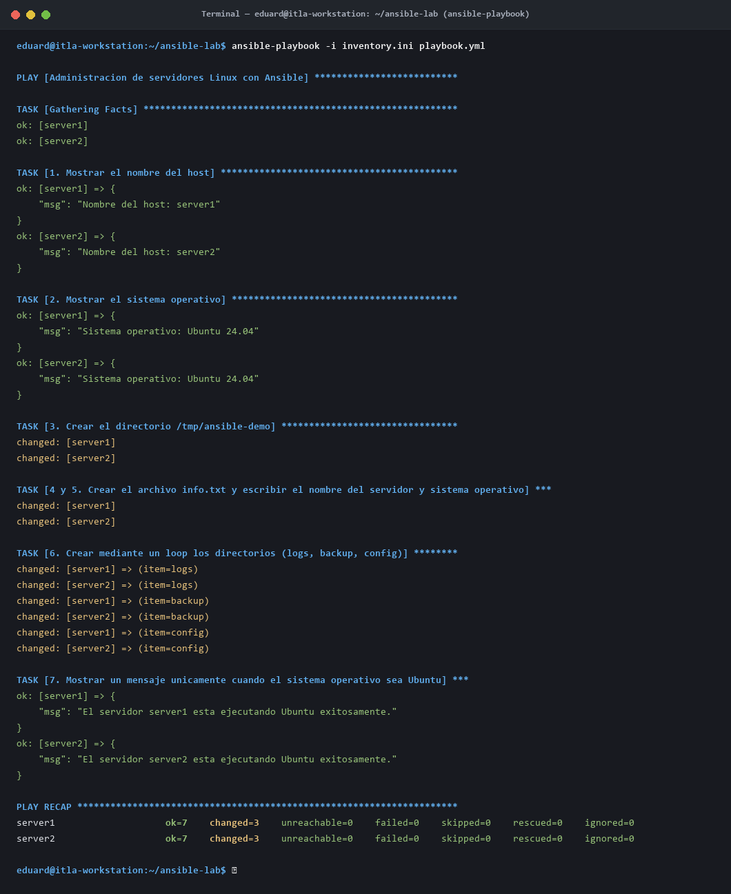

# Laboratorio: Administración de Servidores Linux con Docker y Ansible

Este repositorio contiene la solución completa de la práctica de automatización y gestión de configuración, donde se despliegan dos servidores Linux en contenedores Docker y se administran de forma automatizada mediante **Ansible**.

---

## 🎯 Objetivo de la Práctica

Implementar un entorno de laboratorio basado en dos servidores virtuales **Ubuntu 24.04** utilizando **Docker Compose** y administrarlos de manera remota y centralizada con **Ansible** a través del conector nativo de Docker (`ansible_connection=docker`), ejecutando tareas automatizadas de recopilación de hechos (facts), gestión del sistema de archivos, bucles (loops) y ejecución condicional (`when`).

---

## 📁 Estructura del Repositorio

```text
ansible-lab/
├── docker-compose.yml       # Definición de los servidores server1 y server2 en Ubuntu 24.04
├── inventory.ini            # Inventario de Ansible utilizando conexión docker directa
├── playbook.yml             # Playbook con las tareas de automatización requeridas
├── screenshot_playbook.png  # Captura de pantalla de la ejecución exitosa
└── README.md                # Documentación detallada del laboratorio
```

---

## 🚀 Comandos para Iniciar los Contenedores

### 1. Iniciar los servidores Docker
Desde la raíz del proyecto (`ansible-lab/`), ejecuta:

```bash
docker compose up -d
```

### 2. Verificar que ambos contenedores estén ejecutándose
```bash
docker ps
```

Deberás observar los contenedores `server1` y `server2` activos con el comando `sleep infinity`.

### 3. Instalar Python en cada contenedor
Ansible requiere Python en los nodos administrados para ejecutar sus módulos. Se instala ejecutando:

**Para server1:**
```bash
docker exec -it server1 bash
apt update
apt install -y python3
exit
```

**Para server2:**
```bash
docker exec -it server2 bash
apt update
apt install -y python3
exit
```

*(O de forma directa en una sola línea por servidor):*
```bash
docker exec server1 sh -c "apt update && apt install -y python3"
docker exec server2 sh -c "apt update && apt install -y python3"
```

---

## 🔌 Configuración del Inventario y Prueba de Conexión

El archivo `inventory.ini` define el grupo `[docker]` con ambos servidores:

```ini
[docker]
server1 ansible_connection=docker
server2 ansible_connection=docker
```

Para verificar la comunicación con los servidores antes de aplicar el playbook:

```bash
ansible docker -i inventory.ini -m ping
```

**Respuesta esperada:**
```json
server1 | SUCCESS => {
    "ping": "pong"
}
server2 | SUCCESS => {
    "ping": "pong"
}
```

---

## ⚙️ Tareas Realizadas por el Playbook (`playbook.yml`)

El playbook automatiza las siguientes tareas en ambos servidores:
1. **Mostrar el nombre del host** (`ansible_hostname`).
2. **Mostrar el sistema operativo** (`ansible_distribution` y versión).
3. **Crear el directorio** `/tmp/ansible-demo`.
4. **Crear el archivo** `info.txt` dentro de `/tmp/ansible-demo/`.
5. **Escribir en el archivo** el nombre del servidor y el sistema operativo.
6. **Crear mediante un loop** los subdirectorios:
   - `logs`
   - `backup`
   - `config`
7. **Mostrar un mensaje condicional** únicamente cuando el sistema operativo sea Ubuntu (`when: ansible_distribution == "Ubuntu"`).

---

## ▶️ Comando para Ejecutar el Playbook

Para aplicar la configuración automatizada en ambos servidores:

```bash
ansible-playbook -i inventory.ini playbook.yml
```

> **Nota para entornos Windows:** Si ejecutas desde Windows y no tienes Ansible instalado directamente en el host o WSL, puedes ejecutar el playbook utilizando el runner Docker montando el socket:
> ```bash
> docker run --rm -v /var/run/docker.sock:/var/run/docker.sock -v ${PWD}:/ansible -w /ansible ansible-runner ansible-playbook -i inventory.ini playbook.yml
> ```

---

## 📸 Captura de Pantalla de la Ejecución Exitosa

A continuación se muestra la evidencia de la ejecución exitosa del playbook en ambos servidores (`server1` y `server2`), con todas las tareas completadas y `failed=0`:



---

## 🔍 Comprobación de Resultados en los Servidores

Para verificar que los archivos y directorios fueron creados correctamente por Ansible:

```bash
# Inspeccionar estructura generada en server1
docker exec server1 ls -la /tmp/ansible-demo

# Ver contenido de info.txt en server1
docker exec server1 cat /tmp/ansible-demo/info.txt

# Inspeccionar estructura generada en server2
docker exec server2 ls -la /tmp/ansible-demo

# Ver contenido de info.txt en server2
docker exec server2 cat /tmp/ansible-demo/info.txt
```

---

## 🛑 Detener el Laboratorio

Una vez concluida la práctica, los contenedores pueden detenerse con:

```bash
docker compose down
```
